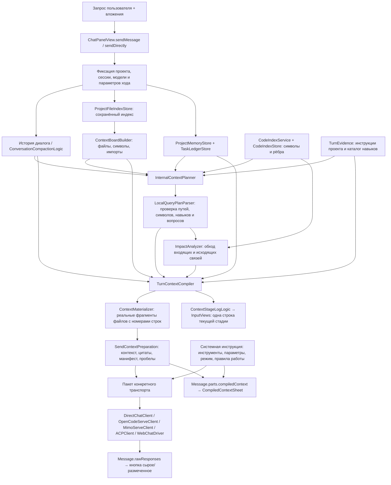

# Отправка, контекст и анализ последствий изменения

Карта исходного кода от 2026-11-03. Это описание пути и границ проверки; результаты последнего прогона фиксируются отдельно в чеклисте.

| Ответственность | Файлы |
|---|---|
| Отправка и привязка к сессии | `myCoder/Sources/Views/ChatPanelView.swift`, `SendRouteResolver.swift`, `SendUserMessageAppendLogic.swift` |
| Сборка контекста | `SendContextPreparationLogic.swift`, `TurnContextCompiler.swift`, `ContextMaterializer.swift` |
| Внутренние модели и их маршруты | `InternalModelStore.swift`, `TurnContextPlanningService.swift`, `TurnPresentation.swift` (`InternalContextPlanner`), `LocalQueryPlanner.swift` |
| Файловый индекс и доска | `ProjectFileIndexStore.swift`, `ProjectFileIndexEventUpdater.swift`, `ContextBoardBuilder.swift`, `ContextCandidates.swift` |
| Граф | `CodeIndexService.swift`, `CodeIndexStore.swift`, `CodeIndexModels.swift`, `CodeIndexExtractor.swift` |
| Анализ последствий | `ImpactAnalyzer.swift`: исходящие и входящие связи, глубина и лимит, вопросы и фрагменты зависимостей |
| Память и состояние задачи | `ProjectMemoryStore.swift`, `TaskLedgerStore.swift`, `TaskLedgerExtraction.swift` |
| Правила проекта и навыки | `TurnEvidence.swift`, `MyCoderPaths.swift` |
| Системная инструкция и доступные инструменты | `WebToolProtocolEmulator.swift`, `PlanModePromptBuilder.swift`, `TurnDelivery.swift` |
| Отображение контекста и сырого ответа | `Views/Components/MessageRowView.swift`, `TurnPresentation.swift`, `RawAnswerToggleLogic.swift` |
| Прогресс | `ContextStageLogLogic.swift`, `App/MyCoderApp.swift`, `Views/Components/InputViews.swift` |
| Диагностика через локальный API | `ContextPreviewService.swift`, `ContextPreviewLogic.swift`, `ContextStateSnapshotLogic.swift`, `AppActionRouter.swift`, `MyCoderAPIServer.swift` |

Пути файлов Services в таблице относительны `myCoder/Sources/Services/`.

## Что должен проверять харнесс

Пример «кадры теперь в RAM»: найти механизм сохранения, его потребителей и вызываемые им операции; проверить настройки пути, выбор папки, валидацию, очистку, экспорт, миграцию ранее сохранённых данных, тесты и документацию. Для каждой связи нужен вывод: обновить / удалить / оставить с причиной. Сам факт смены хранения не даёт права удалить экспорт: он может остаться самостоятельной функцией.

Порядок работы: воспроизводящий тест → новый контракт и критерии → механизм → потребители → UI/настройки и ставший ненужным код → регрессия. Модель получает вопросы как гипотезы для проверки. Эвристическое ребро не является доказанным вызовом; отсутствие ребра не означает отсутствия зависимости.

## Границы

Граф строится статическим извлечением символов и вызовов, поэтому динамические связи, reflection, bindings, строковые ключи и внешние сервисы могут отсутствовать. Обход ограничен глубиной и числом зависимостей; лимиты и пропуски должны быть видны в контексте. При недоступной внутренней модели используется явно обозначенный детерминированный план. Превью контекста проверяет сборку; оно само по себе не доказывает доставку реальному провайдеру, выполнение инструментов или визуальное состояние окна.

Просмотр показывает исходящий пакет myCoder. Для native/serve/ACP собственные tool schemas и дополнительные инструкции задаёт внешний runtime; этот downstream слой приложение не извлекает. `context-preview` моделирует новый ход без истории/ledger, тогда как сохранённый compiledContext пользовательского сообщения содержит фактическую историю этого хода.
